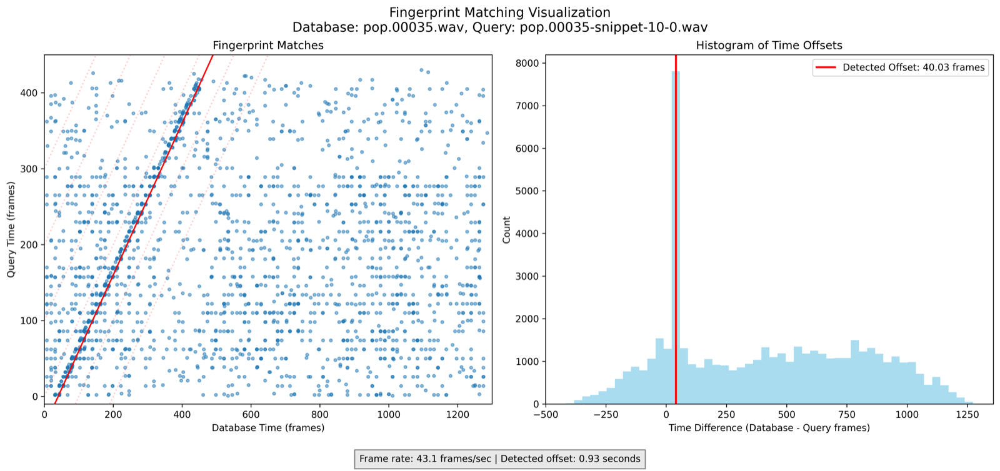
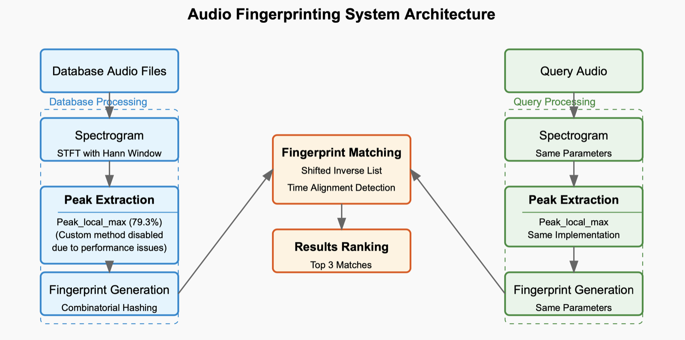

# audio-fingerprinting

A Shazam-style audio identification system in Python, built on the constellation-map approach from Wang (2003): spectral peak extraction, combinatorial hashing, and time-aligned matching. Written for the Music Informatics module of my MSc at Queen Mary University of London (coursework graded 91%).



Matching works by letting query hashes vote on (track, time-offset) pairs. For a correct match, the offset histogram shows a single sharp spike at the true alignment — a signature that survives heavy noise in smartphone-captured recordings.

## Results

Evaluated on 213 smartphone-captured query clips against a 200-track reference database (classical + pop):

| Metric | Score |
|---|---|
| Top-1 accuracy | 79.3% |
| F-measure | 88.5% |
| Precision-recall AUC | 0.87 |

Pop (AUC 0.90) beats classical (0.83): orchestral material has sparser, less stable spectral peaks, so fewer reliable hashes form. My first matcher — a batch-based scorer — managed only 27.2% top-1; replacing it with a shifted inverse-list match with coarse time-difference binning brought it to 79.3%. The report documents that progression plus a parameter study (halving the hop length to 256 pushes top-1 to 80.1% at ~2x compute).

## How it works

1. **Constellation map** — STFT (1024-sample window, hop 512, 22,050 Hz), then local-maximum peak picking over a 15x25 frequency-time neighborhood.
2. **Combinatorial hashing** — each anchor peak is paired with up to 25 target peaks inside a target zone; the (f1, f2, Δt) triples are quantized and packed into integer hashes.
3. **Matching** — query hashes retrieve database postings; each hit votes on a time offset, and the track with the strongest offset consensus wins.



## Usage

The reference/query audio is copyrighted music and not included — point the scripts at your own folders of `.wav` files.

```bash
pip install -r requirements.txt

# build fingerprints for a folder of reference tracks
python fingerprint.py fingerprintBuilder path/to/database/ fingerprints/

# identify a folder of query clips -> writes top-3 matches per query
python fingerprint.py audioIdentification path/to/queries/ fingerprints/ output.txt

# score a results file (per-genre accuracy, precision/recall/F-measure)
python evaluation_metrics.py

# regenerate the spectrogram / constellation / matching figures
python visualization.py --db_audio db.wav --query_audio query.wav --output_dir figures
```

`output.txt` in this repo is the real evaluation run behind the numbers above (one line per query: query file + top-3 matches).

## Files

- `fingerprint.py` — `AudioFingerprinter`: peak extraction, hashing, matching, CLI
- `evaluation_metrics.py` — top-k accuracy, precision/recall/F-measure, per-genre breakdown
- `visualization.py` — generates every figure in the report
- `report.pdf` — full write-up: method, parameter study, failure analysis

## Reference

Wang, A. (2003). *An Industrial-Strength Audio Search Algorithm.* ISMIR.
